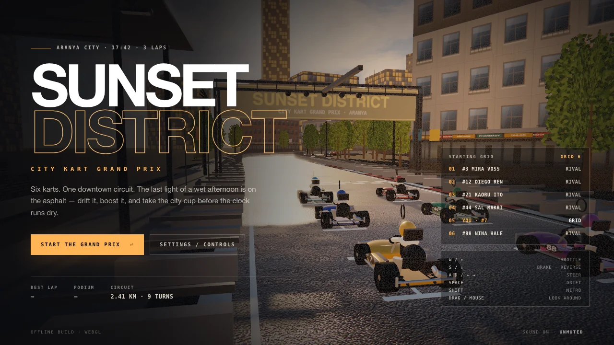
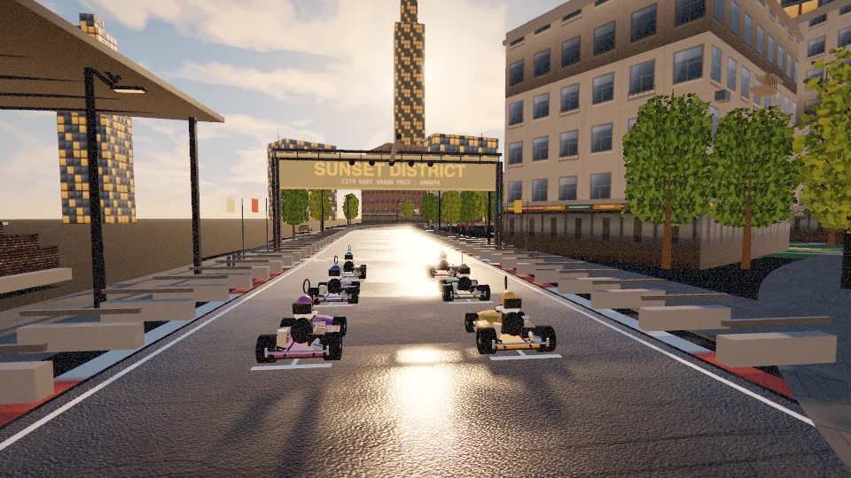
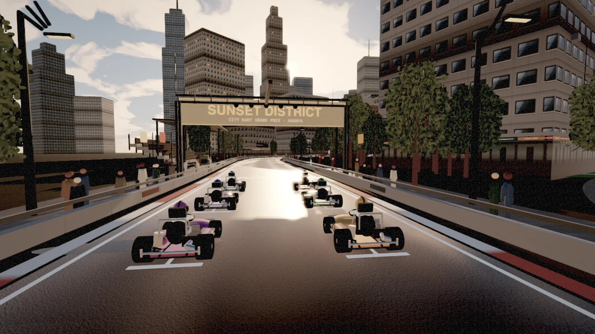
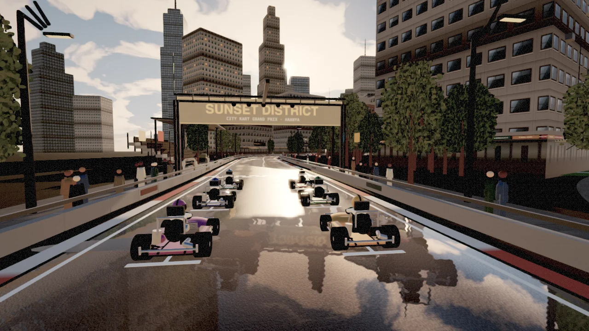
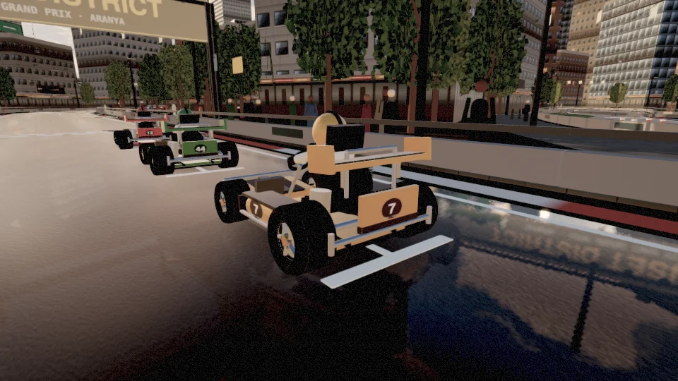
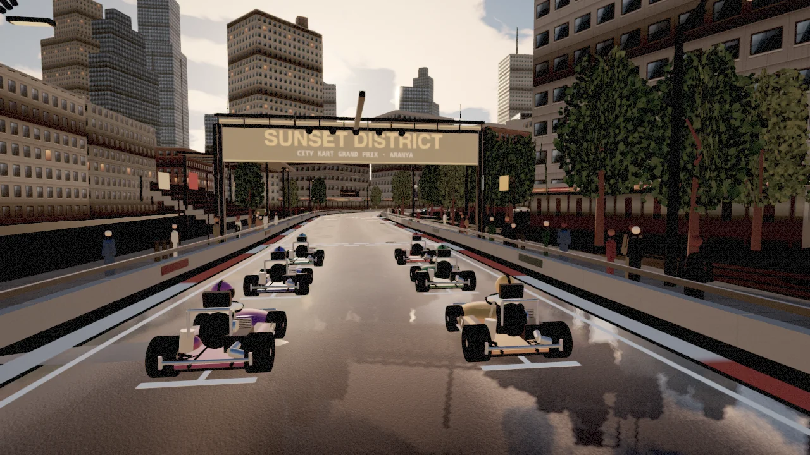
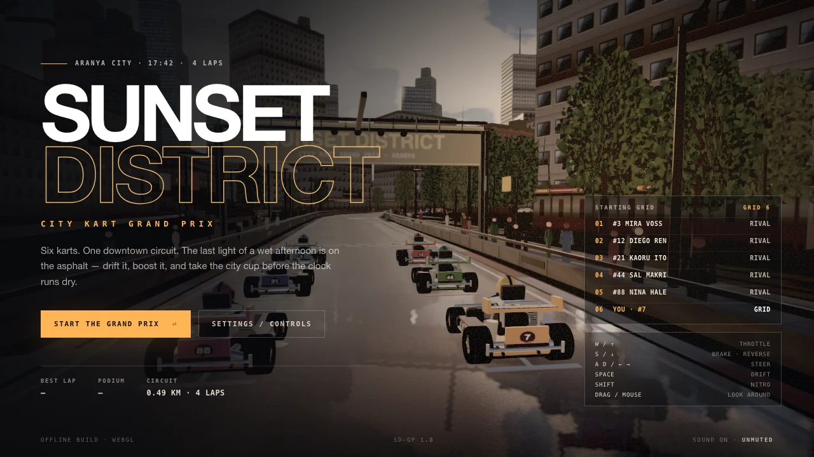
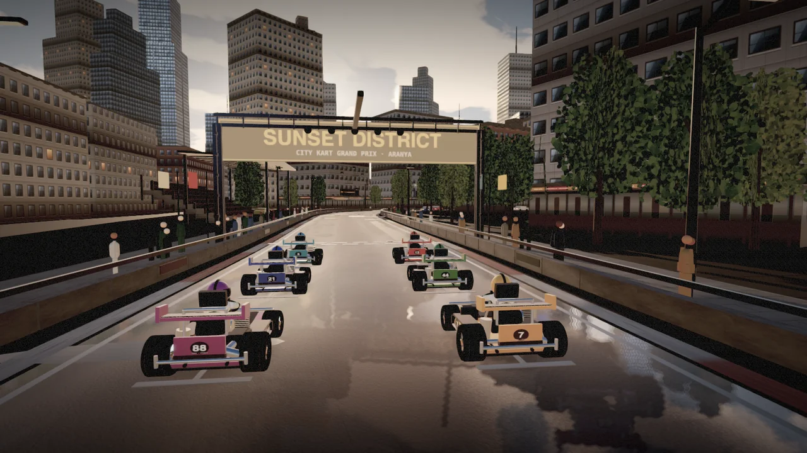

# SUNSET DISTRICT — build record

This is the iteration record for **SUNSET DISTRICT**, a code-generated city kart
racer. The build used the **`photoreal-game`** skill: a procedure for turning a
code-generated 3D scene into a short, playable, photographic game.

The deliverable is [index.html](index.html). The visual record is
[process.html](process.html); the gallery lives in `assets/`.

---

## The brief and the constraints

- A **3D city kart racer** that is complete and playable in one HTML file.
- **No reference material** was used: no reference photos, no external assets, no
  web look target. Every asset is generated by code.
- A recorded iteration process and screenshots were required.
- **No personal data** in the published site.

The art direction stayed fixed throughout:

| Decision | Content |
|---|---|
| Subject | A city kart grand prix on a wet downtown street circuit, 17:42 |
| Time / weather | Golden hour after rain; low sun down the canyon, cool sky fill |
| Key | Directional sun at ~16° elevation, warm, long shadows; one shadow map |
| Sky / ambient | Procedural gradient + warped cloud deck, PMREM environment, hemisphere and a cool bounce |
| Materials | Wet asphalt with clear coat and planar reflection, stone paving, brick/stucco/concrete/curtain-wall facades, painted metal, rubber |
| Focal point | Start gantry and the player's kart on the grid; the city canyon frames them |
| Constraints | No flat sky, no flat foreground, no ungrounded props, no network assets |

## The skill: how it shaped the work

The **`photoreal-game`** skill prescribes the order of work:

1. **Make the render observable** — a headless capture path, a fixed seed, fixed
   cameras and page hooks (`__READY`, `__STATS`, `__PRODUCT`, `__TEST`).
2. **Write the art-direction brief** before adding detail.
3. **Light first** — one dominant source, an environment for reflections and
   fill, fog driven by the sky.
4. **Materials** — variation in albedo, roughness and normal; grime by world
   position, not only UV.
5. **Composition and density** — a dimensioned kit, multiple scales, multiple
   depth layers, a signature surface.
6. **Image formation** — AA, a single tonemap, sRGB once, bloom, grain, vignette.
7. **A real loop** — a verb, a system that answers, feedback, failure and a
   session length; the title/settings/pause/save/touch shell is product.
8. **Executable gates** — product, mobile, census, collision, lights, playtest
   and look. A gate outranks an opinion.

Two consequences for this project:

- **The shell and loop came first.** The city's first frame was ugly, but the
  title, race, pause, settings, persistence and restart existed before the
  lighting pass.
- **The stock walker/cargo gates were re-expressed.** `collide.mjs` and
  `playtest.mjs` assume a walkable rectangular set and hard-coded cargo. This is a
  barrier-lined circuit, so the collision/loop contract was re-built around the
  page's own track data: 204 barrier AABBs, a lateral clamp, barrier push/stop,
  open-road progress, 31 scripted checks. The page still exposes the standard
  hooks for a generic harness.

## Round 0 — first light



The pipeline existed: inlined Three.js, seeded RNG, procedural asphalt/paving/
facades/signs/leaves, a Catmull–Rom circuit, procedural karts, a sky, a shadow sun
and a custom ACES/bloom/FXAA post chain.

The first frame exposed gross defects: the **barrier boxes were rotated 90°** and
read as a comb of concrete blocks across the road; the hero camera was inside the
grandstand roof; the street was too wide; the palette was neon; the title card
covered the karts.

**Verdict:** keep the pipeline; fix geometry and composition. No look score was
trusted while three gross defects remained.

## Round 1 — correct the circuit, compose the grid



The player moved to the back-right grid slot; the camera moved inside the barrier
line; the grandstand moved off the sightline; the barriers became continuous
concrete and steel; the landmark towers were rebuilt; a dense background city
fabric replaced empty ground; a top-down check confirmed the circuit as a circuit.

**Verdict:** composition accepted. The frame still read "generated": saturated
trees and brick, flat storefronts, no surface variation.

## Round 2 — materials and colour



- Facade atlas rewritten as 5 bays × 5 floors with recessed windows, blinds,
  sills, rain streaks, 3.5% lit windows and a normal map from the relief.
- Asphalt rewritten with gutters, tyre ruts, sheet water, wet roughness and a
  clear coat.
- Neon foliage muted; 102 instanced spectators; larger signs, awnings, blade
  signs; FXAA added; composite desaturated.

Measured on the fixed frame:

```
colourfulness   107.6 → 40.6
midtones         51.8% → 59.6%
clipped hi        1.0% → 0.69%
flat tiles        10%  → 7%
```

**Verdict:** accepted; remaining failure was that "wet" was only a texture.

## Round 3 — the signature surface



A half-resolution mirrored camera renders the scene with the road and ground
hidden. The physical road material samples it through:

- screen-space projection with a small ripple warp,
- Fresnel × roughness wetness mask,
- a four-tap blur,
- a maximum blend of 0.52.

This is the visual leap of the project: buildings, karts, trees and sky now sit in
the asphalt. It also exposed that the rims were invisible (solid tyre caps).

**Verdict:** accepted; the signature system is present in every race frame.

## Round 4 — hero object and city density




- Tyre sidewalls opened so rims, spokes, brake discs, lug nuts and "SUNSET"
  sidewall lettering are visible.
- Wedge nose, front wing, rear wing, number plates, engine, exhaust, harness,
  driver suit, visor and helmet.
- Background block grid with setbacks, rooftop units and two landmark towers.
- Detail maps for metal, concrete, wood, roof, rubber, cloth and water; all real
  textures were counted by the census.

**Verdict:** accepted for the product; at 2.6 m the kart is legible but remains a
code-built kit, recorded as a remaining gap.

## Round 5 — product shell and a real loop



Title, settings, pause, save, touch, win, loss and restart. Four laps, five AI
rivals, drift/nitro, six boost pads, three cone zones, a 4:00 clock, health, live
classification and a podium finish.

**Gates found real defects, not just pixels:**

- The pause/settings screens computed to **`opacity: 0`** immediately after being
  shown because `.modal` carried a fade-in animation. A screen with zero opacity
  is not a screen. Removed the animation; the panel still animates.
- The playtest's first drift assertion was wrong: nitro was already full and the
  drift had ended in a mini-turbo, which reset its timer. The mechanic worked; the
  test asserted the wrong visible consequence. It now tests the mini-turbo.

A batch edit later overwrote the game module and blanked the page. The module was
reconstructed from the build transcript, all later patches were replayed, and
every subsequent round was checkpointed in git. That failure mode is part of the
record.

## Round 6 — tone, evidence, final captures



The first final stills crushed blacks: **7.24%** of the hero and **12.13%** of the
close were clipped. The fix was a shadow lift near black, a softer vignette, more
sky bounce, and a lit front-three-quarter close camera at 2.6 m.

```
hero   clip 0.01 / 1.63%   midtones 67.0%   flat 0%
close  clip 0.07 / 2.08%   midtones 64.8%   flat 7%
```

Both still cameras pass tone + emptiness. The final surface is a stylised
photographic look, not a photograph.

## Evidence

| Gate | Result |
|---|---|
| Product | PASS — 635 calls / 539,243 tris / 4 lights; screens, settings, pause, save, touch, objective, roles, tools, cameras |
| Mobile | PASS — 390 × 844, no overflow, title usable, touch present |
| Census | PASS — 435 meshes / 759 instances, 0 failures |
| Lights | PASS — 4 lights, anchored |
| Playtest | PASS — 31/31 (title/race, pause/settings, persistence, accelerate, drift/turbo, 4-lap win, timer fail, wreck, restart, barrier push/stop, open road) |
| Look | PASS (fallback) — tone + emptiness; no external reference |
| Offline | No external requests; Three.js inlined; all textures canvas-generated |

## What is still not photoreal

- The kart is a code kit; at 2.6 m its wing, seat and arms read as designed
  primitives, not a manufactured vehicle.
- The city is box massing with a facade atlas; from above it reads as a block
  diagram.
- The crowd is two instanced draws; the trees are billboard clusters.
- The look gate is tone + emptiness because no reference imagery was permitted.
- No mobile GPU profile was captured; quality presets expose the tradeoff.

## Credits & licensing

- **Method:** `photoreal-game` skill.
- **Rendering:** Three.js r169, MIT, inlined.
- **Content:** all assets generated at runtime; no external images, fonts or
  audio.
- **License:** MIT for the original code and generated content (see
  [LICENSE](LICENSE)); Three.js notice in
  [THIRD_PARTY_NOTICES.md](THIRD_PARTY_NOTICES.md).

No usernames, emails, local paths, analytics, cookies or third-party requests are
included in this site.
