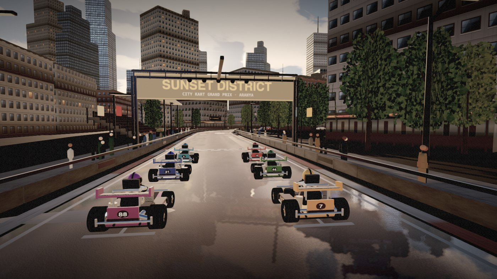
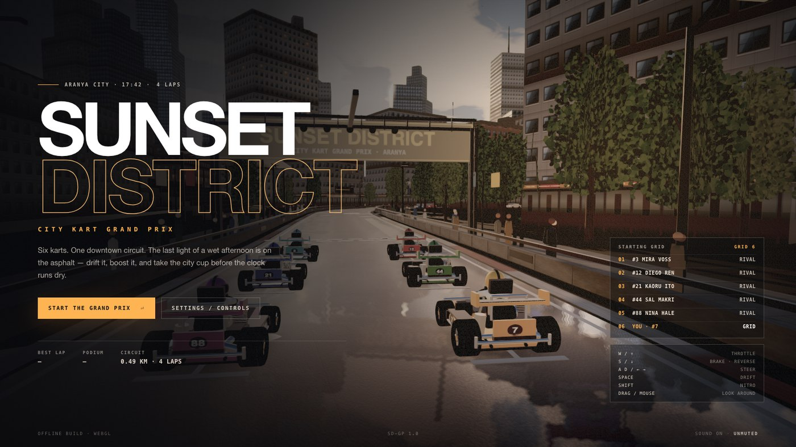
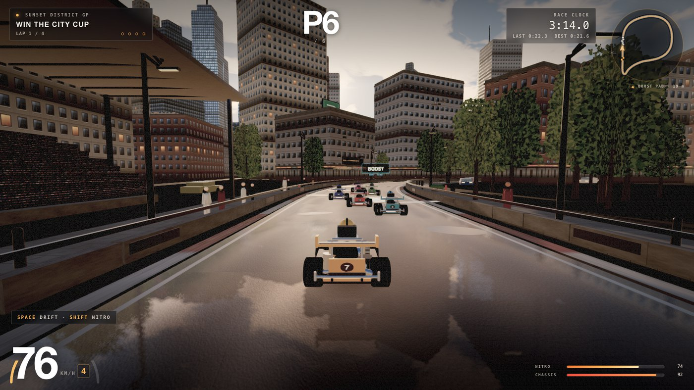
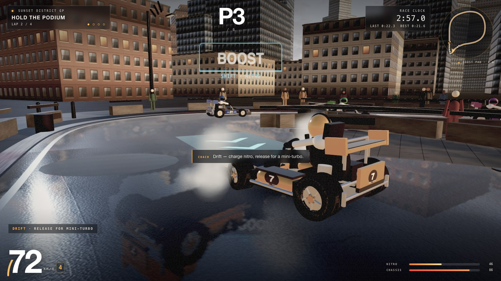
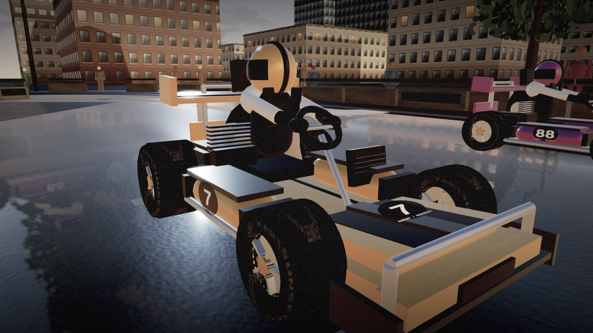
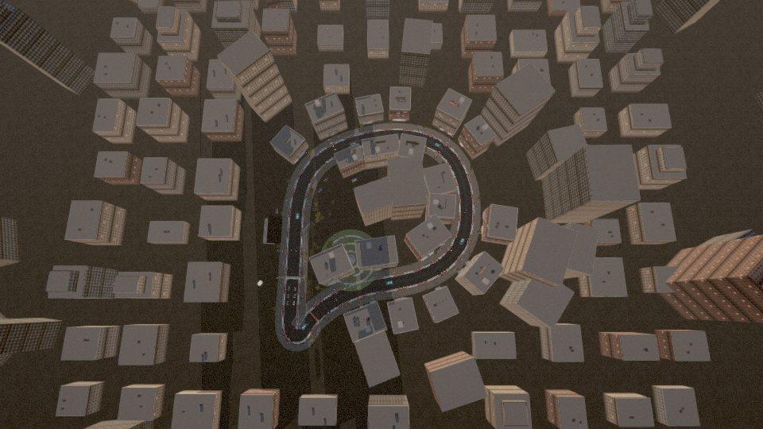
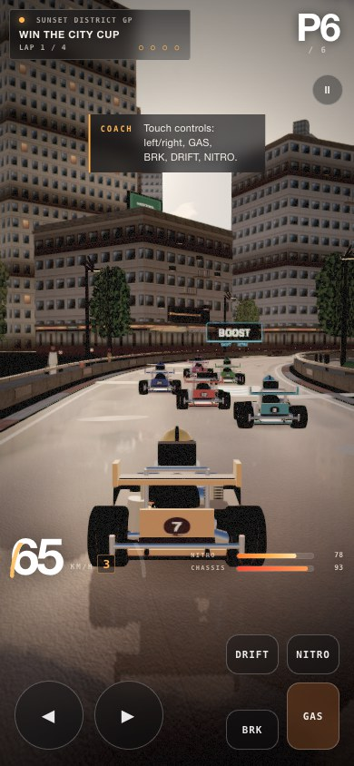
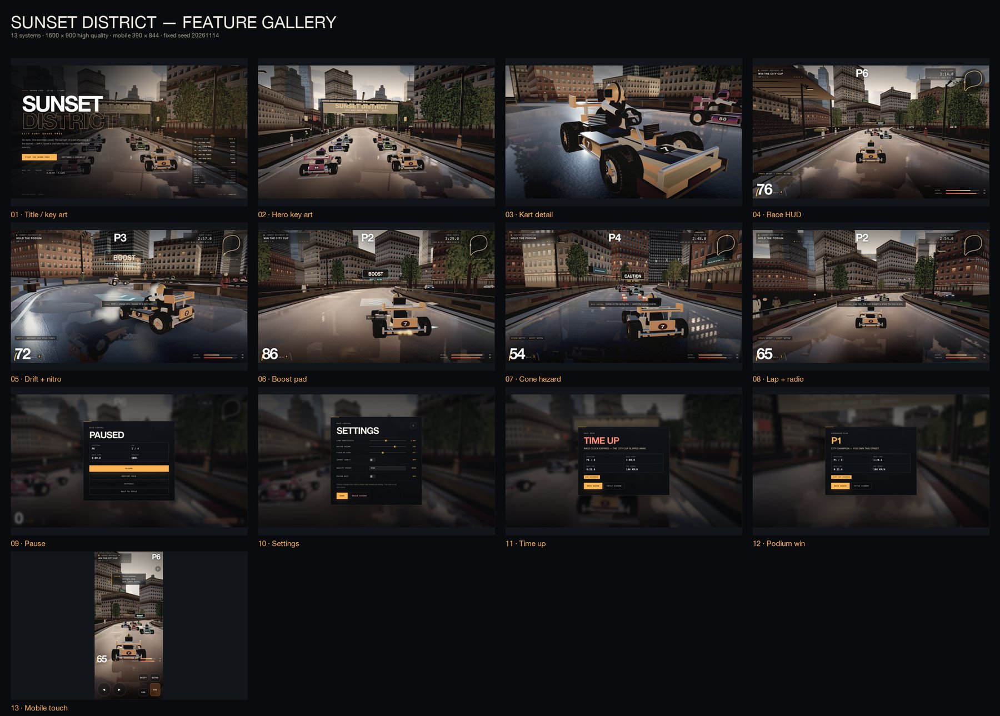
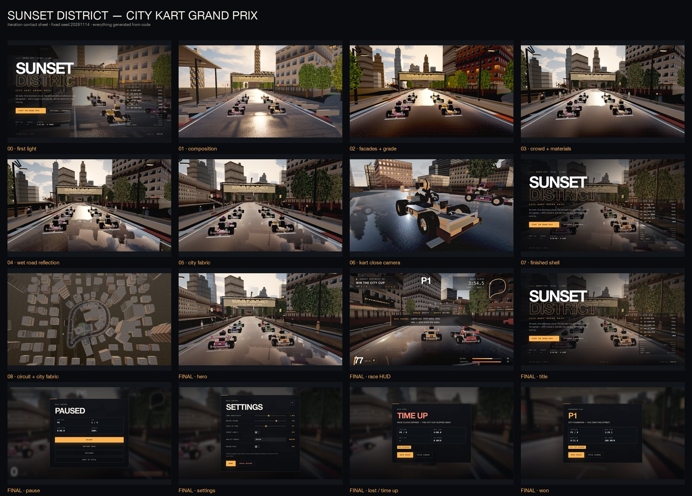

<div align="center">
  
  <h1>SUNSET DISTRICT</h1>
  <p><strong>CITY KART GRAND PRIX</strong><br>
  A complete, playable 3D city kart racer in one self-contained HTML file.</p>
  <p>
    <a href="https://norwinyu.github.io/sunset-district/">▶ PLAY IN THE BROWSER</a>
    &nbsp;·&nbsp;
    <a href="https://norwinyu.github.io/sunset-district/process.html">BUILD LOG + FEATURE GALLERY</a>
    &nbsp;·&nbsp;
    <a href="PROCESS.md">PROCESS.md</a>
  </p>
</div>

> Four laps on a wet downtown circuit. Five rivals. A kart you can read down to
> the tyre lettering. A title, settings, pause, save, win/loss and touch shell.
> Every city block, facade, kart, tree, texture and sound is generated by code at
> load time. **No external assets and no network requests.** All names and the
> city are fictional.

---

## Contents

- [At a glance](#at-a-glance)
- [Screens](#screens)
- [The race](#the-race)
- [What is in the game](#what-is-in-the-game)
- [How it looks](#how-it-looks)
- [How it was made — the photoreal-game skill](#how-it-was-made--the-photoreal-game-skill)
- [The build in six rounds](#the-build-in-six-rounds)
- [Under the hood](#under-the-hood)
- [Source & build](#source--build)
- [Verification](#verification)
- [Run, deploy, privacy](#run-deploy-privacy)
- [Known limits](#known-limits)
- [Credits & license](#credits--license)

---

## At a glance

| | |
|---|---|
| **Play** | [Single HTML](index.html) · offline · no account · no downloads |
| **Race** | 4 laps · 5 AI rivals · start P6 · podium target |
| **Circuit** | 0.49 km downtown loop · 10 turns · 6 boost pads · 3 cone zones |
| **Clock** | 4:00 race clock · per-lap repair · DNF on time or wreck |
| **Input** | Keyboard + mouse · touch at 390 × 844 |
| **Look** | Golden-hour city, wet planar-reflective asphalt, ACES/Bloom/FXAA |
| **Tech** | Three.js r169 inlined · procedural textures/audio · single file |
| **Evidence** | Product PASS · mobile PASS · 31/31 playtest · census 0 failures · 4 lights |
| **Build** | Dependency-free Node + local Three.js source; no runtime build |
| **License** | MIT for original code/content; Three.js MIT notice included |

---

## Screens

The screens below are **real captures**, not painted promo art. The title frame is
the live city; the HUD is the actual runtime interface.

| Title / key art | Race HUD |
| :---: | :---: |
|  |  |
| The title uses the start grid and the city as its background. The player kart is #7, fifth row, right; five rivals ahead. | The full loop is visible: objective and lap, P6 and the race clock, speed/gear, nitro/chassis, minimap, compass and radio subtitles. |

| Drift / nitro | Kart detail |
| :---: | :---: |
|  |  |
| Drift is not a particle effect: slip angle, tyre smoke, skid marks, nitro charge and the release mini-turbo all come from the same physics step. | The 2.6 m camera is the harshest asset test: open-face wheels, brake discs, sidewall lettering, engine, harness and driver. |

| Top-down circuit | Mobile touch |
| :---: | :---: |
|  |  |
| A closed Catmull–Rom spline with a dense block fabric around it. The top-down check happens before the street dressing. | 390 × 844: steering, GAS/BRK, DRIFT/NITRO and pause. The HUD reflows without horizontal overflow. |

### All 13 feature stills



Title, hero key art, kart detail, race HUD, drift, boost pad, cone hazard, lap +
radio, pause, settings, time-up, podium win and mobile touch. Full-size 1600 × 900
versions and captions live in the [feature gallery](https://norwinyu.github.io/sunset-district/process.html#features).

---

## The race

You start **P6** on the grid. Four laps. Podium or nothing.

- **Drive / drift.** `Space` drops the rear and charges nitro; release after a
  moment for a mini-turbo. The kart's velocity and heading are separate, so a
  drift is a real slide, not a canned animation.
- **Nitro.** `Shift` spends the tank. Six glowing boost pads top it up.
- **Hazards.** Three cone zones sit on the racing line; contact costs chassis
  and speed. Barriers and rival contact do too.
- **Survive.** The chassis repairs 14% at each completed lap. At 0% the run ends.
- **Beat the clock.** The 4:00 race clock is a real failure state; so is a P4+
  finish.
- **Persist.** Best lap, best finish and settings live in `localStorage`.

### Controls

| Input | Action |
|---|---|
| `W` / `↑` | throttle |
| `S` / `↓` | brake / reverse |
| `A D` / `← →` | steer |
| `Space` | drift — charge nitro, mini-turbo on release |
| `Shift` | nitro |
| mouse drag | look around (auto-recentres) |
| `Esc` | pause · `M` mute · `R` restart |
| touch | left/right, GAS, BRK, DRIFT, NITRO, pause |

---

## What is in the game

| Feature | What it does | Where |
|---|---|---|
| **Title / shell** | Live key art, start, settings, grid list, records, process link | [gallery](https://norwinyu.github.io/sunset-district/process.html#features) |
| **Race loop** | 4 laps, 5 AI rivals, live classification, lap timing, best lap | in game |
| **Drift model** | Slip-angle grip, nitro charge, mini-turbo, smoke/skids | in game |
| **Nitro** | Boost tank, six pads, exhaust flame, FOV/shake | in game |
| **Cone hazards** | Three zones, chassis damage, world markers, repair | in game |
| **HUD** | Objective, lap, position, clock, speed/gear, nitro, chassis | in game |
| **Navigation** | Minimap, compass, boost-pad marker, caution marker | in game |
| **Radio** | Contextual subtitles, lap banners, low-health warnings | in game |
| **AI** | Curvature-based speed, racing line, avoidance, catch-up window | in game |
| **Failure states** | Time up, wrecked, P4+; named causes on the end screen | in game |
| **Win state** | Podium class, race time, best lap, top speed, rematch | in game |
| **Settings** | Sensitivity, volume, FOV, invert-Y, quality, mute, erase record | in game |
| **Persistence** | Best lap / best finish / settings in `localStorage` | in game |
| **Touch** | Steering, gas, brake, drift, nitro, pause; compact HUD | 390 × 844 |
| **Audio** | Synthesised engine, wind, tyre screech, boosts, impacts, chimes | in game |

---

## How it looks

The look is a deliberate photographic direction built from six systems:

1. **A single key.** A low golden sun down the canyon, a PMREM sky environment,
   a sky-tinted hemisphere and a cool bounce from the camera side.
2. **Wet asphalt as the signature surface.** A half-resolution mirrored camera
   renders the city with the road hidden. The road material samples it through a
   Fresnel × roughness wetness mask, a ripple warp and a four-tap blur. Puddles
   add their own normal map and clear coat.
3. **Materials with more than colour.** Procedural asphalt, paving, four facade
   families, metal, concrete, wood, rubber, cloth and water; each varies albedo,
   roughness and normal. Facades carry a normal map generated from their relief.
4. **A dimensioned city.** The circuit, barriers, sidewalks, lamps, trees,
   benches, kiosks, cars, crowd and skyline are built at real-world scales. The
   block grid is added after the circuit is checked from above.
5. **A code-authored hero.** The kart is assembled from primitives: a wedge
   fairing, exposed chassis, engine, exhaust, open-face wheels, brake discs,
   number plates, rear wing, driver, harness and visor. At 2.6 m it is still a
   designed object, but it is a legible one.
6. **Filmic image formation.** HDR scene target, ACES tone mapping, bloom, FXAA,
   subtle chromatic aberration, grain, vignette and a measured desaturation.

There is **no external reference imagery**. The project brief required building
it independently, so the look gate ran in the skill's tone + emptiness fallback
mode: clipping, midtones, flat tiles and measured detail, not similarity to a
photograph.

---

## How it was made — the `photoreal-game` skill

This build followed the **`photoreal-game`** skill: a procedure for turning a
code-generated 3D scene into a short, playable, photographic game. The skill's
order shaped the project:

- **Product before look.** The title, race loop, settings, pause, save, touch
  path, win/loss and restart existed before the art pass.
- **One dominant light** and an environment for reflections/fill; no flat ambient
  box.
- **Materials with more than albedo.** Roughness, normal, grime and wear.
- **Multi-scale composition** — a kart at 2.6 m, barriers at 5–10 m, facades at
  20–60 m, towers and skyline behind.
- **A real loop.** A verb, a system that answers, feedback, failure and a session
  length; the shell is product, not decoration.
- **Executable gates.** Product, mobile, census, collision, lights, playtest and
  look. The gate outranks opinion. The stock walker/cargo gates were re-expressed
  for a barrier-lined circuit with the page's own track data.

The project is also honest about the process: see the
[full build log](https://norwinyu.github.io/sunset-district/process.html) and
[PROCESS.md](PROCESS.md) for every round, every fixed camera, the gate numbers and
the remaining gaps.

---

## The build in six rounds



| Round | Change | Finding |
|---|---|---|
| **00** | Pipeline + first frame | Barriers were rotated across the track; camera was inside the grandstand roof; palette was neon. |
| **01** | Correct circuit + composition | Continuous barriers, back-right grid slot, camera inside the circuit, city fabric. |
| **02** | Materials + colour | 5×5 facades with normal maps, wet asphalt, crowd; colourfulness **107.6 → 40.6**, midtones **51.8% → 59.6%**. |
| **03** | Planar wet-road reflection | The signature surface; buildings, karts, trees and sky in the asphalt. |
| **04** | Hero object + city density | Open wheel faces, rims/brake discs/tyre text, wedge nose, wing, engine; dense block grid. |
| **05** | Product shell + a real loop | Four laps, AI, drift/nitro, pads, cones, clock, health; pause/settings opacity bug fixed by the gate. |
| **06** | Tone + final evidence | Hero clipped blacks **7.24% → 1.63%**; close **12.13% → 2.08%**, flat **15% → 7%**. |

The full-size iteration frames, including the failed ones, are in the
[iteration gallery](https://norwinyu.github.io/sunset-district/process.html#iterations).

---

## Under the hood

- **One file for players.** Three.js r169 is inlined; all textures are canvas
  output; all audio is WebAudio synthesis. The page makes no external requests.
- **The city.** A closed Catmull–Rom spline (1600 samples) generates the road
  ribbon, curbs, sidewalks, barrier line, collision limits and AI path. Buildings
  line the circuit; the block grid fills the background; the top-down check runs
  before street dressing.
- **The karts.** Procedural meshes merged by material; animated wheels, steering,
  body roll/pitch, exhaust flame, brake light and contact shadow. The HUD and
  chase camera are tuned around the back of the kart.
- **AI.** Curvature-based target speed, racing-line offset, local avoidance and a
  bounded catch-up rule. Rival karts are real bodies in the collision loop.
- **Post.** Custom HDR render target → bright pass → Gaussian blur → ACES + FXAA +
  grain/vignette composite. The planar reflection is a separate half-res pass,
  disabled below HIGH.
- **Shell.** DOM/CSS title, settings, pause, end screens, touch controls, settings
  persistence and a phase state machine; the game keeps rendering behind the
  shell.
- **Quality.** LOW/MEDIUM/HIGH/ULTRA presets for pixel ratio, shadow map, MSAA,
  bloom and reflection. Mobile defaults to MEDIUM.

---

## Source & build

The playable `index.html` is a built artifact; the source is included in this
repository.

```
index.html                  the single-file game (deployed root)
process.html                visual build record + 13-shot feature gallery
PROCESS.md                  the text iteration log
src/
  index.template.html       page shell
  style.css                 HUD and shell design
  js/00-core.js             renderer, textures, sky, post chain, planar reflection
  js/10-world.js            circuit, city, props, crowd, billboard
  js/20-kart.js             kart model, particles, skid marks
  js/30-game.js             race loop, physics, AI, camera, shell, HUD, audio
  js/*.js                   concatenated in filename order by the build
vendor/three.module.js      Three.js r169 source used by the build
build.mjs                   inlines Three.js + CSS + JS into dist/sunset-district.html
assets/                     rendered feature and iteration stills
media/                      README images
LICENSE / THIRD_PARTY_NOTICES.md
.nojekyll
```

Build with Node only:

```bash
node build.mjs
# writes dist/sunset-district.html
```

The deployed root `index.html` carries two site-only additions on top of the
built game: a meta description and a `PROCESS / SKILL` footer link. The game code
itself is identical. `node_modules` is not required.

---

## Verification

| Gate | Result |
|---|---|
| Product | **PASS** — 635 draw calls / 539,243 triangles / 4 lights; title, settings, pause, save, touch, 4-step objective, 3 roles, 2 tools, 2 cameras |
| Mobile 390×844 | **PASS** — scroll 390 × 844, no horizontal overflow, title usable, touch present |
| Playtest | **PASS** — 31/31: accelerate, drift/mini-turbo, full 4-lap win, timer failure, wreck, restart, barrier push/stop, open road |
| Census | **PASS** — 435 meshes / 759 instances, 0 failures |
| Lights | **PASS** — 4 lights, anchored |
| Look | **PASS (fallback)** — hero clip 0.01/1.63%, midtones 67.0%, flat 0%; close clip 0.07/2.08%, midtones 64.8%, flat 7.0% |
| Offline | No external requests; Three.js r169 inlined; all textures canvas-generated |

The source of these numbers, the raw gate outputs and the collision adaptation are
on the [build log](https://norwinyu.github.io/sunset-district/process.html#gates)
and in [PROCESS.md](PROCESS.md).

---

## Run, deploy, privacy

**Play now:** [norwinyu.github.io/sunset-district](https://norwinyu.github.io/sunset-district/)  
**Process / gallery:** [process.html](https://norwinyu.github.io/sunset-district/process.html)

**Run locally:** open `index.html`. The page needs no server, build or network.
(If a browser restricts `localStorage` on `file://`, serve the folder statically.)

**Deploy a fork:**

1. Push this repository (or the release zip's contents) to GitHub.
2. **Settings → Pages → Build and deployment → Deploy from a branch → `main` /
   `(root)`**.
3. The site appears at `https://<user>.github.io/<repo>/`. No build step is
   needed; `.nojekyll` is included.

**Privacy:**

- No analytics, cookies, tracking, accounts, comments or external requests.
- Only `localStorage` keys for best lap, best finish and settings.
- The published site and screenshots contain no usernames, emails, local paths or
  logs. The city and driver names are fictional.
- The repository's commit history uses a neutral project identity; it does not
  include the local developer's git identity.
- The source and the game are MIT for original content; Three.js is MIT with its
  notice retained.

---

## Known limits

The target was a photographic *direction*, not a claim that this is
indistinguishable from a photograph. The remaining gaps are recorded here and in
the process page:

- At 2.6 m the kart is still a code-authored kit: the wing, seat and arms read as
  designed primitives, not a manufactured vehicle.
- The city is box massing with a facade atlas; from above it reads as a block
  diagram, even if the street-level facades carry the scene.
- The crowd is two instanced draws and the trees are billboard clusters, not
  individually modelled.
- No external reference imagery was permitted, so the look gate is tone +
  emptiness, not an external similarity score.
- No mobile GPU frame-time profile was captured; quality presets expose the
  tradeoff and mobile defaults to MEDIUM.

---

## Credits & license

- **Method:** [`photoreal-game`](https://norwinyu.github.io/sunset-district/process.html) —
  the procedure, art-direction brief, iteration loop and acceptance gates.
- **Rendering:** Three.js r169, MIT, inlined into the page.
- **Content:** every city block, facade, texture, kart, tree, spectator, sign,
  particle and sound is generated at load time; no external images, fonts or audio.
- **Original code and generated content:** MIT — see [LICENSE](LICENSE).
- **Three.js notice:** see [THIRD_PARTY_NOTICES.md](THIRD_PARTY_NOTICES.md).
- The page is a static folder: no server, no account, no comments, no telemetry.
